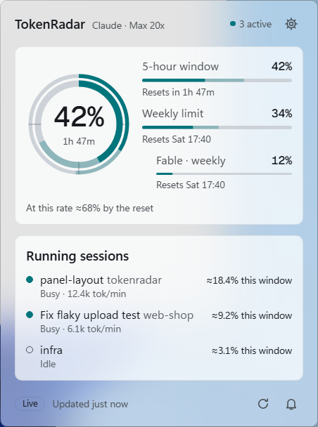

# TokenRadar

> A tiny, tray-first radar for your AI coding agent usage limits.

TokenRadar sits in the Windows tray and shows how much of your **Claude Code** 5-hour and weekly limits you have used, which sessions are running, and when the next limit is likely to hit. It is local only, has no telemetry and never reads your conversations.

**Status: v0.1, the first public release.** Windows 10/11 (x64). Codex, macOS and Linux come later (see [Roadmap](#roadmap)).

<p align="center">
  <picture>
    <source media="(prefers-color-scheme: dark)" srcset="docs/img/panel-dark.png">
    
  </picture>
  <br>
  <sub>The tray panel (sample data).</sub>
</p>

## Features

- **Live limits in the tray.** A two-ring icon shows the weekly limit (outer ring) and the 5-hour window (inner ring). The tooltip has the exact numbers and reset times.
- **Tray panel.** One click opens a small panel: both windows with their reset times, a projection of when a limit fills up, running sessions with their projects, and where every number comes from. Its **Details** view adds the pace against the time gone, the weekly time strip, a usage chart and each session's cost.
- **Notifications.** Thresholds you choose (75 %, 90 % and 100 % by default), a warning when the current pace fills a limit before it resets, a last warning before full, reset announcements and quiet hours.
- **Statusline bridge.** Claude Code's status line hands TokenRadar the exact `rate_limits` it gets from Anthropic, with no extra request (see below).
- **Usage API, only with consent.** If you allow it, TokenRadar asks `api.anthropic.com` for your limit percentages every few minutes, the same request Claude Code makes.
- **Honest numbers.** Every value carries its source: statusline, API or estimate. Estimates are marked with `≈`; low-confidence values are dimmed.
- **Small footprint.** About 25 MB of memory while it sits in the tray, no windows kept alive, near-zero idle CPU.
- **CLI.** `tokenradar status`, `limits`, `sessions` (also as `--json`), `history --json` for the current windows' readings, and `doctor` for a privacy-safe diagnostics bundle.
- **English and Turkish** UI.

## Install

| Method | Command or file | Updates |
|---|---|---|
| winget | `winget install umitkara.TokenRadar` | built in, or `winget upgrade` |
| Scoop | `scoop bucket add tokenradar https://github.com/umitkara/tokenradar` then `scoop install tokenradar/tokenradar` | `scoop update` |
| Installer | `TokenRadar_<version>_x64-setup.exe` from [Releases](https://github.com/umitkara/tokenradar/releases) | built in |
| Portable | `TokenRadar_<version>_x64-portable.zip` from [Releases](https://github.com/umitkara/tokenradar/releases) | download the new zip |

- The installer is per user and needs no administrator rights. It installs to `%LOCALAPPDATA%\Programs\TokenRadar` and adds the `tokenradar` CLI to your user `PATH`.
- The portable zip and Scoop keep everything in a `data` folder next to the app. Windows may not show notifications for a portable copy, because it is not registered with a Start menu shortcut, and clicking a notification does not open the panel.
- Every release lists SHA-256 checksums in `SHA256SUMS.txt`.

### Why does SmartScreen warn me?

The installer is not yet code-signed. Code-signing certificates cost money and a new open-source project has no reputation with Microsoft yet, so Windows shows "Windows protected your PC" for the first downloads. Click **More info** → **Run anyway** if the file came from this repository's Releases page and its checksum matches `SHA256SUMS.txt`. winget and Scoop installs usually do not show this warning. Signing through an open-source signing program is planned once the project matures.

## Statusline bridge

Claude Code can run a command to draw its status line, and it passes that command a JSON object that includes your current `rate_limits`. TokenRadar uses this:

```sh
tokenradar statusline install
```

The command shows the change to `~/.claude/settings.json`, asks before writing, and keeps a backup next to the file. If you already have a status line command, TokenRadar chains to it: your status line keeps working and TokenRadar only reads the payload. `tokenradar statusline uninstall` restores the previous setting. The onboarding window and Settings → Data sources offer the same with a button.

The bridge is the most accurate source: the numbers come straight from Anthropic, at no extra request. TokenRadar falls back to the usage API (if you allowed it) and then to an estimate from your local logs.

The line itself looks like this on an account without a 5-hour window:

```
7d ███│█░░░░ 41% ⏱ 43% · 3d4h │ Fable 22% │ ctx 38% │ ≈2.1% this session │ API $4.12
```

`│` on the bar and `⏱ 43%` mark how much of the window's time has passed, so you can see whether your use runs ahead of the clock. `API $4.12` is what the session would cost at API prices, not your bill.

The line is a list of items you arrange in Settings → Statusline or in `config.toml`. Besides the limits there are session items (context, cost, model, tokens, durations, lines changed, vim mode, agent, version, session id), project items (folder, project folder, git branch, read from `.git/HEAD` without running git) and layout items (line break, separator, space, flexible space, custom text). Each item can have its own format, label and color; on limits the color is the one below 75 %, and the warning and critical colors always win.

Separators are items too: the line draws what the list holds. A separator at the edge of a group, or next to an item with no value, is left out. A `flex` item fills the free width: items after one flex go to the right, and items between two go to the middle.

```toml
[statusline]
version = 2         # separators are items
theme = "plain"     # plain | powerline | powerline_round (needs a Powerline font)
separator = "│"     # the glyph of new separators
color = "auto"      # auto (honours NO_COLOR) | always | never
margin = 0          # free columns on the right, 0–8

[[statusline.items]]
kind = "seven_day"
format = "percent"  # bar | percent
color = "bright_cyan"

[[statusline.items]]
kind = "separator"
text = "│"

[[statusline.items]]
kind = "context"

[[statusline.items]]
kind = "flex"

[[statusline.items]]
kind = "git_branch"
color = "green"

[[statusline.items]]
kind = "space"
width = 2           # 1–8 columns

[[statusline.items]]
kind = "model"
```

Claude Code cuts the last four columns of the line, so TokenRadar leaves them free; `margin` adds more, which helps right after the window gets narrower. A table without `version` gets a separator between each two values when it is read, and looks as before. Without `items`, the 12c keys still work: `segments`, `layout = "single" | "double"`, `bar` and `pace`.

## Claude Code mod (experimental)

`integrations/claude-code/` holds an optional mod for Claude Code's plugin hooks. It works alongside the statusline bridge and does not replace it: the bridge keeps feeding TokenRadar, and the mod shows and warns inside Claude Code.

- **Band above the prompt.** One bordered line with a mini bar. It appears only when a limit reaches 75 % (90 % in red), or when TokenRadar projects that a window fills before it resets. From the window's second day on (its first seventh), when your use runs 10 points or more ahead of the window's elapsed time, it says so too, without a toast. **Details** opens the pane; **Hide** keeps the band away until the level rises. When a window resets, the band says so once.
- **Toast.** One per threshold crossing, and only while the desktop app is not running. When the app runs, it sends the notification itself.
- **`/radar` opens a pane.** A card per limit with its bar, time mark, source badge, reset time and projection; the weekly time strip (days, now, and where the time line stands at the end of each day); a chart of your use over the window against the time line (an SVG in the desktop app, VS Code and mobile, colored cells in the terminal); live sessions with their cost; and the context window. Where no pane can be shown, `/radar` prints the full report instead, with a pace line and the weekly time line.
- **Status entry.** If Claude Code's status line is not TokenRadar's bridge, the mod shows a short entry such as `TokenRadar · Weekly 42% ⏱43%`. With the bridge installed it stays quiet.

The mod reads Claude Code's own limit figures and runs `tokenradar status --json` at most every 30 seconds for what only TokenRadar knows, and `tokenradar history --json` at most every 5 minutes while the pane is open. Without the CLI it still works with Claude Code's figures and says so. Of Claude Code's `settings.json` it reads only `statusLine.command`. It reads no conversation (live sessions are shown by name or folder, never by title), makes no network request and never touches credentials. The API is early access and may change between Claude Code releases.

The installer ships the mod. To turn it on, use the card under the statusline bridge in onboarding, or Settings → Data sources → **Panel inside Claude Code**, or the command line:

```sh
tokenradar mod install
```

This adds the mod's folder to `CLAUDE_CODE_PLUGIN_DIRS` in the `env` block of `~/.claude/settings.json`, with the same diff, confirmation and backup as the statusline bridge. Other folders in that list stay. Restart Claude Code afterwards. `tokenradar mod uninstall` takes it out again, and uninstalling TokenRadar does so too.

Do not also start Claude Code with `--plugin-dir` for this mod, or it loads twice. Left at its default, the mod's **TokenRadar CLI** option in `/config` uses the `tokenradar.exe` installed with the app; clear any path you set there earlier.

To try the mod from a clone of this repository instead:

```sh
claude --plugin-dir integrations/claude-code
```

If `tokenradar` is not on your `PATH` there (a portable install, for example), set the **TokenRadar CLI** option to the full path of `tokenradar.exe`. The mod speaks the language TokenRadar is set to; with a CLI older than 0.1.1 it speaks English.

## Privacy

TokenRadar is local only. There is no account, no telemetry and no analytics.

**What it reads**

- Claude Code's local logs (`~/.claude/projects/**/*.jsonl`): only token counts, model names, timestamps, session ids and project folders. Lines are filtered before parsing, so prompts, responses, tool output and system instructions are never parsed, stored or shown.
- The status line payload, if you install the bridge.
- With your consent only: the `accessToken` in Claude Code's `.credentials.json`, at the moment of a usage request. It is never stored, logged or shown, and it is wiped from memory after use.

**What it never reads**

- Your conversations.
- The `refreshToken`. TokenRadar never renews or changes your sign-in; when the access token expires it waits until Claude Code renews it.
- Codex's `auth.json`.

**Where it connects**

- `api.anthropic.com`, only if you allowed the usage API.
- GitHub Releases, once a day, to look for updates (can be turned off in Settings → About). Updates are signed and are installed only when you click **Install and restart**.

Nothing else leaves your computer. The data lives in `%LOCALAPPDATA%\TokenRadar` (or next to a portable copy). Settings → Privacy & data deletes it; the uninstaller offers to delete it too.

## FAQ

**Is this allowed?**
TokenRadar reads files Claude Code already writes on your computer and, with your consent, makes the same usage request Claude Code makes with your own sign-in. It only observes: it never tries to bypass, reset or game provider limits, and it never changes your credentials.

**Why are some numbers marked `≈`?**
They are estimates from your local logs, used when neither the status line nor the usage API has a recent reading. TokenRadar never shows an estimate as a measurement.

**Does it work with several Claude accounts or WSL?**
Not yet; both are planned for v0.3.

**How do I report a problem?**
Run `tokenradar doctor` (or Settings → Privacy & data → Create diagnostics bundle). It writes a zip without tokens, conversation content, project names or readable paths; check it and attach it to an [issue](https://github.com/umitkara/tokenradar/issues).

## Roadmap

| Version | Focus |
|---|---|
| v0.1 | Live limits in the tray, panel, notifications, statusline bridge, CLI, installer and updates |
| v0.2 | Analytics: calibration, per-session attribution, windows archive, patterns |
| v0.3 | Mini widget, multiple accounts, WSL |
| v0.4 | Codex provider |
| v0.5 | macOS and Linux |

An English summary of the architecture is in [`docs/en/architecture-summary.md`](docs/en/architecture-summary.md). The design documents and the step-by-step plan in [`docs/`](docs/) are in Turkish.

## Contributing

Bug reports, ideas and pull requests are welcome. See [CONTRIBUTING.md](CONTRIBUTING.md) for the development setup and conventions, and [SECURITY.md](SECURITY.md) for reporting vulnerabilities.

## License

[MIT](LICENSE). Third-party licenses ship with every release in `THIRD-PARTY-NOTICES.txt`.
