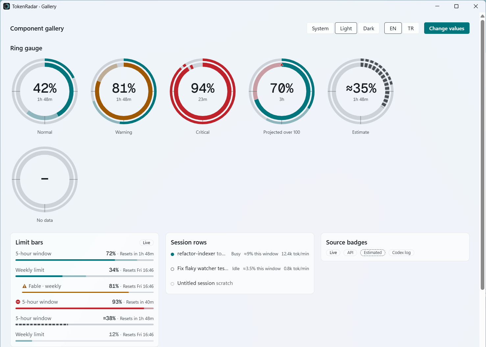
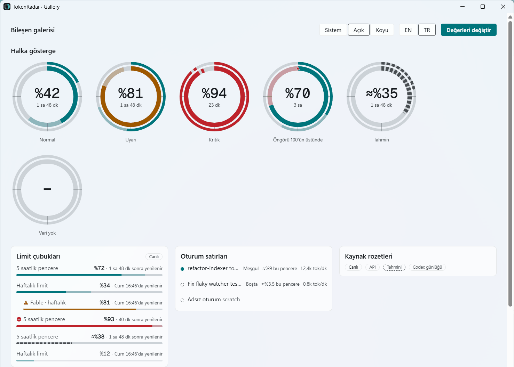
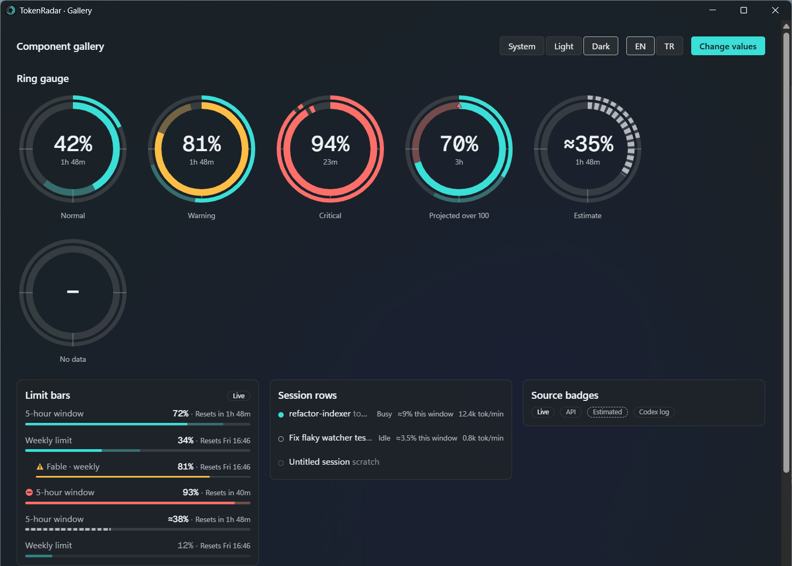
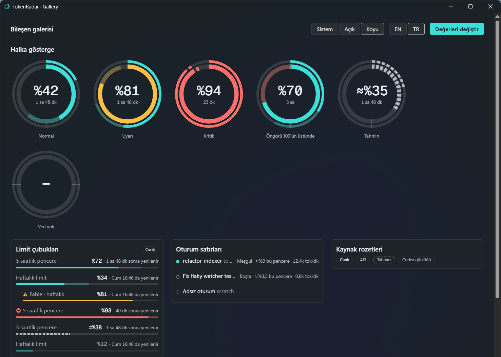

# Adım 09 — Frontend temeli: tasarım token'ları, tema, i18n, tipli köprü

| Sürüm | Bağımlılık | Tahmini süre | Durum |
|---|---|---|---|
| v0.1 | 02, 03 | 1-2 oturum | ✅ |

## Amaç

Tüm pencerelerin üzerine inşa edileceği frontend temelini kurmak:
- Kesinleştirilmiş tasarım token'ları.
- Açık ve koyu tema, Mica/Acrylic zemin.
- Fluent tabanlı i18n (Rust ile ortak kaynak).
- Rust'tan üretilmiş tipli komut ve olay bağlamaları.
- Temel bileşen kütüphanesi ve görsel kontrol için bir galeri sayfası.

## Önce oku

- `docs/design-language.md` (tamamı)
- `docs/architecture.md` §4, §12, §13 (CSP)
- `docs/performance-budget.md` (bundle bütçeleri)
- `docs/decisions.md`: ADR-010, ADR-019

## Kapsam

- **Tasarım kesinleştirme:** `frontend-design` ve/veya `impeccable` skill'i ile `design-language.md`'deki önerileri gerçek Mica zemin üzerinde dene, token değerlerini sabitle ve dokümanı güncelle.
- `app/src/lib/styles/`: `tokens.css` (renk, tipografi, boşluk, yarıçap, hareket), `themes.css` (açık/koyu + `forced-colors`), `base.css` (reset, odak halkaları).
- Font: Alt kümesi alınmış mono variable font (woff2) + lisans dosyası (OFL). Alt küme alma script'i `scripts/subset-font.*`.
- Pencere zemini: Tauri `windowEffects` (Mica/Acrylic) + şeffaflık. Windows 10 için opak yedek, işletim sistemi build numarası Rust'tan alınır.
- i18n (TS):
  - `@fluent/bundle` + `locales/*.ftl` dosyalarının Vite ile içe aktarılması.
  - `NUM`/`PCT`/`DUR`/`TR_SUFFIX` fonksiyonları (TS).
  - Svelte için `t()` yardımcısı ve dil store'u.
  - `<html lang>` yönetimi.
- Tipli köprü:
  - `tauri-specta` ile `app/src/lib/ipc/bindings.ts` üretimi.
  - Komut iskeleti: `get_panel_snapshot`, `get_settings`, `set_locale`, `set_theme`.
  - Olay aboneliği yardımcısı: pencere görünürken abone olur, gizlenince aboneliği bırakır.
- Bileşenler (Svelte 5, runes):
  - `RingGauge` (SVG; dış/iç halka, tick'ler, hayalet projeksiyon yayı, değer geçişi, tek seferlik tarama)
  - `LimitBar`, `Countdown`, `SourceBadge`, `SessionRow`, `Card`, `Button`, `IconButton`, `Toggle`, `Tooltip`, `Skeleton`, `EmptyState`
- **Paylaşılan zamanlayıcı:** Tek bir 1 Hz ticker kullanılır. `document.visibilityState === "hidden"` olduğunda **durur**. Tüm geri sayımlar bu ticker'a abone olur; bileşen başına `setInterval` kullanılmaz.
- Galeri sayfası `gallery.html`: yalnızca geliştirme derlemesinde bulunur. Tüm bileşenler × açık/koyu × EN/TR × durumlar.
- Bundle bütçe kontrolü (`scripts/check-bundle-size.mjs`) ve bunun CI'a eklenmesi.

## Kapsam dışı

- Panel sayfasının kendisi (Adım 10), ayarlar ve onboarding sayfaları (Adım 11).
- uPlot ve grafikler (Adım 15).

## Görevler

- [x] Tasarım skill'ini yükle ve `design-language.md` ile çalış. Mica üzerinde kontrastı ölç (açık ve koyu duvar kağıtlarıyla). Token'ları `tokens.css`'e yaz, dokümandaki değerleri güncelle.
- [x] Tema mantığı:
  - `prefers-color-scheme` izlenir; kullanıcı ayarı (`system | light | dark`) önceliklidir.
  - Mica `system` modunda işletim sistemi temasını izler.
  - `data-theme` ve `data-os="win11|win10"` öznitelikleri `<html>` etiketine yazılır.
- [x] `RingGauge`:
  - Prop'lar: `outer` (haftalık), `inner` (5s), `projection`, `state`, `estimated`.
  - Tahmini değerler kesikli çizgiyle gösterilir.
  - Kritik durumda çentik eklenir.
  - `aria-label` tam cümle olarak i18n'den gelir.
  - `prefers-reduced-motion` desteklenir.
  - Değer değiştiğinde 400 ms geçiş ve tek seferlik conic tarama efekti oynar. **Sürekli animasyon yoktur** (ADR-019).
- [x] i18n:
  - `locales/{en,tr}/common.ftl` ve `panel.ftl` (Adım 10 için temel anahtarlar).
  - TS fonksiyonları `testdata/i18n-vectors.json` ile test edilir. Adım 08 henüz yapılmadıysa bu dosyayı burada oluştur; Adım 08 aynı dosyayı kullanır. **İki tarafın aynı vektörlerden geçmesi zorunludur.**
  - **Parite testi** (Vitest): EN ve TR `.ftl` dosyalarında anahtar kümeleri ve her mesajdaki değişken adları birebir aynı olmalı.
  - Biçimlendirmede TS tarafı `Intl` kullanır, ama çıktılar ortak vektörlerle karşılaştırılır. TR için `Intl.NumberFormat('tr-TR', {style:'percent'})` çıktısı `%72` olmalı; doğrula.
- [x] Tipli köprü: `specta` tipleri (`PanelSnapshot`, `LimitView`, `SessionShareView`, `CoreEvent`) TS'e üretilir. Üretim debug derlemede otomatik yapılır, CI'da "üretilen dosya güncel mi?" kontrolü bulunur.
- [x] Olay köprüsü (Rust): `CoreEvent` → yalnızca **açık** pencerelere `emit`. Pencere yokken serileştirme maliyeti bile ödenmez.
- [x] Galeri sayfası ve ekran görüntüleri: açık/koyu × EN/TR için temel durumların görüntüleri devir notuna eklenir.
- [x] Bundle bütçesi: panel girişi için ≤ 60 KB JS ve ≤ 15 KB CSS (gzip). Aşılırsa CI kırmızıya düşer.

## Teknik notlar ve tuzaklar

- **Şeffaf pencere ve Mica:** Tauri 2'de `transparent: true` + `windowEffects: { effects: ["mica"] }`. HTML ve body arka planı şeffaf olmalı; kartlar yarı saydam `--surface-1` kullanır. Mica yalnızca pencere **odaktayken** canlı görünür, odak kaybında düz renge döner. Tasarım bu durumu da kaldırmalı.
- **Acrylic ve Windows 10:** Windows 10'da Acrylic pencere sürüklenirken takılma yapabiliyor. Bu nedenle Windows 10'da varsayılan opak yedek kullanılır.
- **Svelte 5 runes:** Global durum için `$state` içeren `.svelte.ts` modülleri kullanılır. Store'lar sade tutulmalı; tüm hesaplama Rust'ta yapılır.
- **Türkçe büyük harf:** CSS `text-transform: uppercase` doğru sonuç vermesi için `lang="tr"` gerektirir. JS tarafında `toLocaleUpperCase(lang)` kullanılır. Testte "istatistik" → "İSTATİSTİK" dönüşümü doğrulanmalı.
- Font alt kümesi alırken `font-feature-settings: "tnum"` için gerekli OpenType tablolarının (`tnum`) korunduğundan emin ol.

## Kabul kriterleri

- [x] Galeri sayfası tüm bileşenleri açık/koyu ve EN/TR olarak doğru gösterir. Mica zeminde metin kontrastı AA seviyesindedir.
- [x] TS ve Rust i18n vektör testleri aynı dosyadan geçer. Parite testi yeşildir.
- [x] Bağlamalar otomatik üretilir ve CI'da tazelik kontrolü vardır.
- [x] Bundle bütçesi içinde kalınır.
- [x] `design-language.md` kesinleşmiş token değerleriyle güncellenmiştir.

## Doğrulama

```powershell
pnpm -C app test
pnpm -C app check
pnpm -C app build; node scripts/check-bundle-size.mjs
pnpm dev   # galeri: tray menüsünde (debug) "Gallery" veya doğrudan gallery.html
```

## Devir notu

**Tarih:** 2026-10-27 · **Dal:** `step/09-frontend-foundation` · **Karar:** ADR-031 · **Ölçüm:** `docs/perf/2026-10-27-frontend.md`

### Yapılanlar
- **Token'lar ve stiller (`app/src/lib/styles/`):** `tokens.css` (`light-dark()` renk çiftleri, tip ölçeği, boşluk, yarıçap, hareket; azaltılmış harekette süreler 0), `themes.css` (`data-theme` → `color-scheme`, `data-os=win10` opak yüzeyler, `forced-colors`), `base.css` (reset, odak halkası, `.readout`, `.visually-hidden`). `color.ts` + `tokens.test.ts`: OKLCH → sRGB, Mica/Acrylic zemin aralığına bindirilerek WCAG kontrastı; Rust `SOLID_*` eşitliği.
- **Font:** Geist Mono variable alt kümesi 12,8 KB (`scripts/subset-font.py`, `app/src/lib/fonts/`, OFL).
- **Zemin (Rust):** `chrome.rs` her pencereyi giydirir: açılış betiği (`__TOKENRADAR_BOOT__`), tema, Win11'de şeffaflık + Mica (panelde build ≥ 22523 ise Acrylic), Win10'da opak renk. `tray/system.rs::os_build()` registry'den build numarası.
- **Ayarlar (Rust):** `prefs.rs` (`SettingsView`, `SettingsChanged`, config.toml ayrı thread'de okunur), `config.rs`'te `LocalePref`/`ThemePref` ve `save_general` (`toml_edit`, yorumlar korunur).
- **Tipli köprü:** `ipc.rs` — `get_panel_snapshot`, `get_settings`, `set_locale`, `set_theme`; olaylar `core-event-emitted`, `settings-changed`. `CoreEvent` yalnızca görünür pencerelere gider; görünür pencere yoksa serileştirme yok. `bindings.ts` debug açılışında üretilir, `bindings_are_fresh` testi CI'da tazeliği denetler (`UPDATE_BINDINGS=1` ile yenilenir).
- **i18n (TS):** `format.ts`/`suffix.ts` (Rust portu), `fluent.ts` (`NUM`/`PCT`/`DUR`/`TR_SUFFIX`), `i18n.svelte.ts` (`t()`, `setLocale`, `<html lang>`, `upper()`), `catalogs.ts` (sayfa başına `.ftl` alanları). Yeni `.ftl`: `common`, `panel`, `gallery` (EN/TR). Vektör ve parite testleri; "istatistik" → "İSTATİSTİK".
- **Zamanlayıcı:** `time/ticker.ts` (tek 1 Hz zincir, abone yoksa veya sayfa gizliyse durur) + `clock.svelte.ts` (`createSubscriber`).
- **Sayfa yardımcıları:** `settings.svelte.ts` (`boot()`), `ipc/core-events.ts` (görünürken dinle, görünür olunca yeniden yükle).
- **Bileşenler (`app/src/lib/components/`):** `RingGauge`, `LimitBar`, `Countdown`, `SourceBadge`, `SessionRow`, `Card`, `Button`, `IconButton`, `Toggle`, `Tooltip`, `Skeleton`, `EmptyState`, `SeverityIcon` ve ortak metin yardımcıları `limit.ts`.
- **Galeri:** `gallery.html` + `src/pages/gallery/` (sentetik fikstürler; T/L/C kısayolları tema/dil/değer değiştirir). Tray menüsünde yalnızca debug'da "Bileşen galerisi"; `TOKENRADAR_GALLERY=1` açılışta açar. Üretim derlemesine girmez.
- **Bundle:** `scripts/check-bundle-size.mjs` + CI adımı (release derlemesinden sonra).
- **Capability'ler:** panel/ayarlar için `core:event` dinleme; galeri için ayrıca `core:window:allow-set-theme`.
- **Düzeltilen hata:** Adım 02 spike komutunun `invoke_handler`'ı tipli komutları eziyordu; tek yönlendiricide birleştirildi.
- **Testler:** frontend 34 (token kontrastı 6, i18n vektör/parite, ticker 4, bileşen SSR 8, panel 1); Rust tümü yeşil (core 203, app 36 + 2 ignored, CLI 17, i18n 16 + 6 vektör).

### Gerçek doğrulama (2026-10-27)
- Galeri `pnpm dev` + sahte limitlerle gerçek Mica üzerinde açıldı; açık/koyu × EN/TR ekran görüntüleri (sentetik veri, görev çubuğu kırpıldı):
  -  
  -  
- Çalışma anında tema değişimi (galeri `setTheme` → Mica rengi de değişiyor) ve dil değişimi yeniden yüklemeden çalıştı. Odak kaybında Mica'nın düz renge dönüşü görüldü; metin okunur kaldı.
- ADR-019: değer değişiminden 2 sn sonra `document.getAnimations()` boş. Bu makinede Windows animasyonları kapalı; azaltılmış hareket yolu da canlı doğrulandı.
- Bundle: panel 19,7 KB JS / 1,3 KB CSS (gzip).

### Sapmalar (ADR-031, kullanıcı kararları)
- TS biçimleme `Intl` değil, Rust'ın elle yazılmış portu (yuvarlama ve `-0` farkları; ICU sürümüne bağımlılık).
- Mono font: Geist Mono.
- `set_locale`/`set_theme` config.toml'a yazar.
- Planda olmayan eklemeler: `DUR(…, "long")` (ekran okuyucu), `resets-in-short` (halka merkezi), `--on-accent` token'ı, `SeverityIcon` bileşeni, galeri kısayolları ve `TOKENRADAR_GALLERY`.

### Açık konular
- **Yüksek kontrast (`forced-colors`):** Stiller yazıldı ama gerçek bir HC temasında denenmedi.
- **Windows 10 opak yedek:** Kod yolu ve kontrast testi var, Windows 10 makinesinde denenmedi.
- **Acrylic panel:** Panel penceresi Adım 10'da gerçek içerikle görülecek; Acrylic üzerinde kontrast yalnızca hesapla doğrulandı.
- **▲ glifi** küçük (7 px); panel boyutunda okunurluğu Adım 10'da yeniden değerlendirilmeli.
- Galeri pencere başlığı (`TokenRadar · Gallery`) Rust'ta sabit metin; yalnızca debug derlemede var.
- `@fluent/bundle` her sayfada Svelte çalışma zamanıyla birlikte ortak parçada; panel bütçesinin büyük kısmı bu.

### Sonraki adıma notlar
- **Adım 10 (panel):** `main.ts` zaten `boot(panelCatalog)` çağırıyor. Veri için `commands.getPanelSnapshot()` + `subscribeCoreEvents({ onEvent, onResume })` kullanın; `onResume` tam snapshot çeker. Halka için `RingGauge` (`outer` = haftalık, `inner` = 5s `LimitView`), satırlar için `LimitBar` (haftalıkta `countdown="absolute"`), oturumlar için `SessionRow`. Hiçbir sayı UI'da hesaplanmaz; `severity`, `freshness`, `projection` backend'den gelir.
- **Adım 10:** Panel `chrome::dress(…, Surface::Transient)` ile Acrylic/Mica alır; `html, body` şeffaf, kartlar `--surface-1`. 360 px genişlikte `SessionRow` adları kısalır (ellipsis); gerekirse pay/hız ikinci satıra alınabilir.
- **Adım 11 (ayarlar):** `commands.setLocale`/`setTheme` hazır; tray'e `TrayMsg::Locale` zaten gönderiliyor. Ayarlar sayfası `settingsCatalog`'a kendi `.ftl` alanını eklemeli.
- **Bağlamalar:** Rust tipi değişince `cargo test -p tokenradar-app bindings_are_fresh` kırılır; `UPDATE_BINDINGS=1` ile yenileyin veya debug uygulamayı bir kez çalıştırın.
