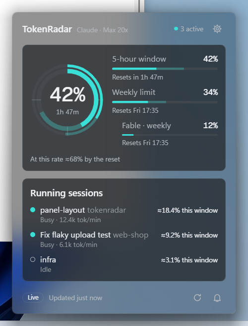
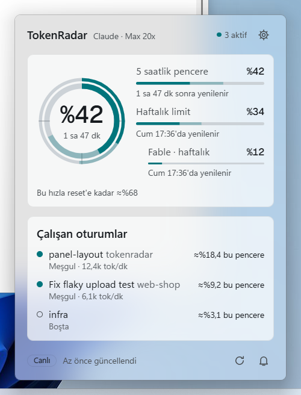
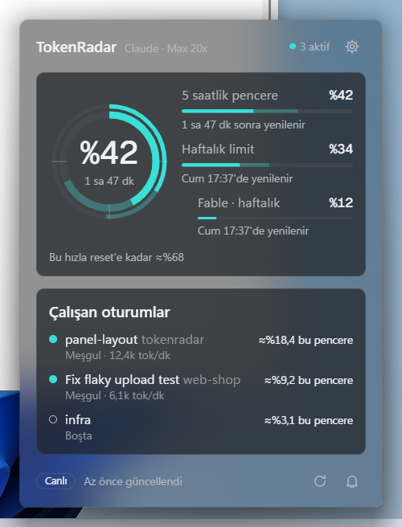
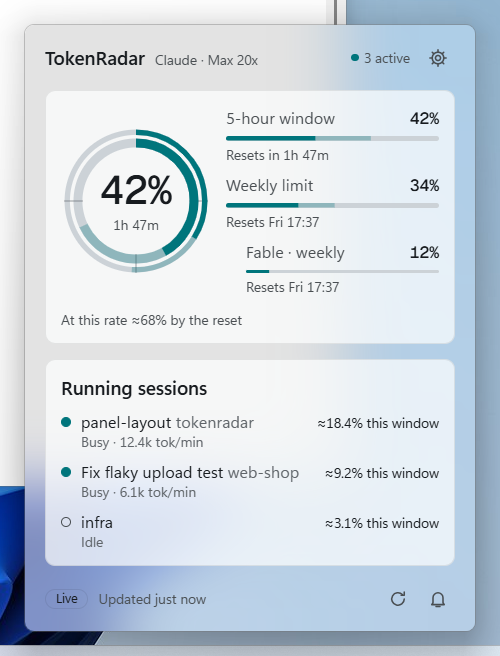
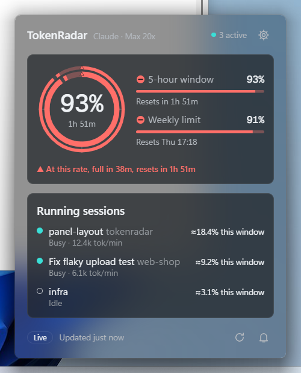
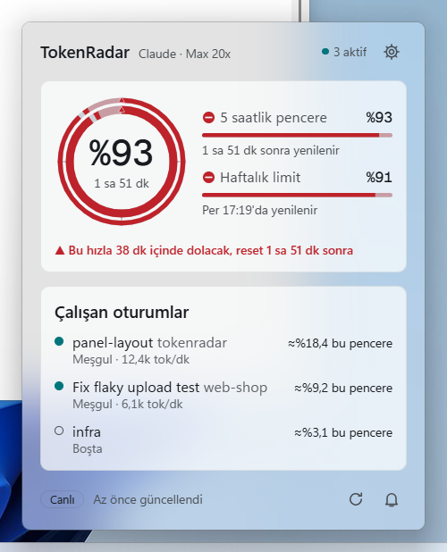
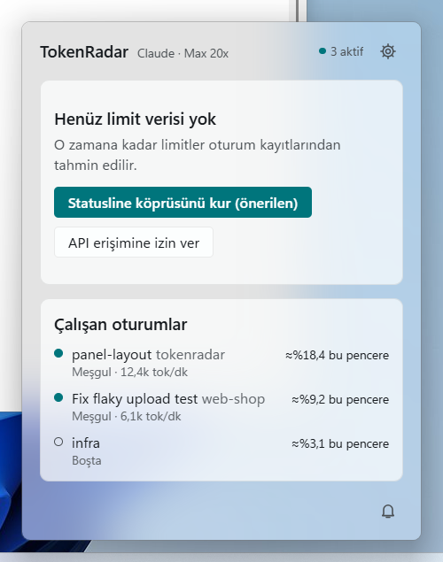
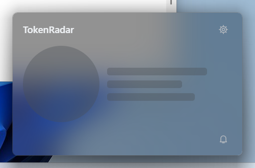
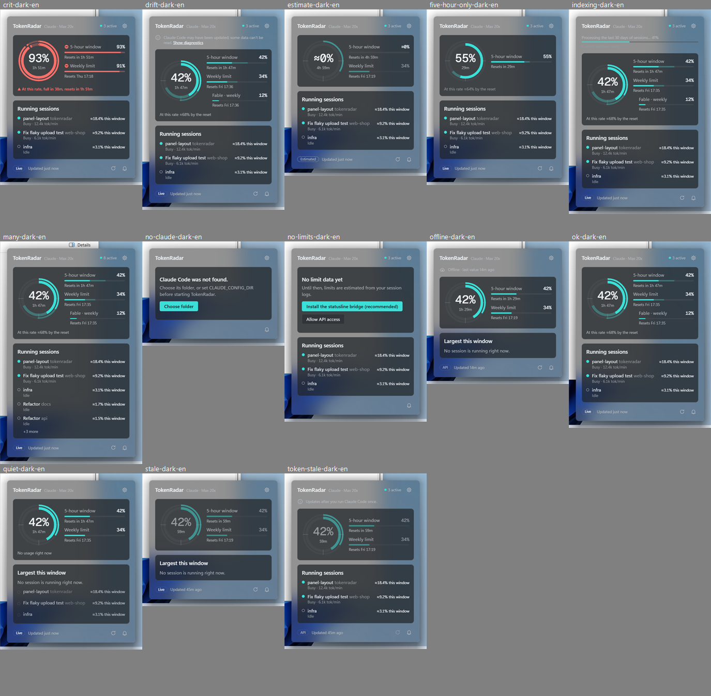

# Adım 10 — Tray paneli

| Sürüm | Bağımlılık | Tahmini süre | Durum |
|---|---|---|---|
| v0.1 | 07, 08, 09 | 1-2 oturum | ✅ |

## Amaç

Tray ikonuna tıklayınca açılan kompakt paneli yapmak. Bu, v0.1'in ana ekranıdır. Panel şu bilgileri gösterir:
- İkili halka ve tüm limitler: 5 saatlik pencere, haftalık, scoped limitler.
- Projeksiyon ve reset geri sayımları.
- Veri kaynağı ve tazelik bilgisi.
- Canlı oturumlar ve her birinin mevcut penceredeki ≈ payı.

Panel sıcakken anında, soğukken ≤ 400 ms içinde açılmalı. Kapatıldıktan sonra belleği geri vermeli.

## Önce oku

- `docs/design-language.md` §4, §5, §6, §7, §9
- `docs/architecture.md` §2 (pencere yaşam döngüsü), §7
- `docs/performance-budget.md` (panel satırları)
- Adım 06'daki `PanelSnapshot` tanımı, Adım 02 spike raporu

## Kapsam

- **Pencere davranışı:** Çerçevesiz, şeffaf, Acrylic, `skipTaskbar`, `alwaysOnTop`, yeniden boyutlandırılamaz. Tray'e göre konumlanır. Odak kaybında (blur) ve `Esc` ile gizlenir. `warm_ttl` (60 s) sonunda yok edilir.
- **İçerik:**
  - Üst bilgi: başlık, canlı oturum sayısı, ayarlar butonu.
  - Halka ve limitler bölümü.
  - Projeksiyon satırı.
  - Oturumlar listesi.
  - Alt bilgi: kaynak rozeti, son güncelleme, "Yenile", "Bildirimleri sustur".
- **Durumlar:** İlk indeksleme sürüyor; limit verisi yok (CTA'lar); bayat veri; token bayat; çevrimdışı; şema sapması.
- **Olaylar:** Panel görünürken `LimitsUpdated` ve `LiveSessionsChanged` olaylarına abone olunur. Panel gizlenince abonelik bırakılır.

## Kapsam dışı

- "Detaylar" (ana pencere) butonu v0.2'de etkinleşir; şimdilik gizli.
- Ayarlar sayfası ve onboarding (Adım 11). CTA'lar şimdilik ayarlar penceresinin ilgili sekmesini açan komutları çağırır; sekmeler Adım 11'de dolacak.

## Görevler

### Pencere

- [x] Konumlama:
  - `tauri-plugin-positioner` (`TrayBottomCenter` vb.) **veya** özel hesaplama kullanılır.
  - Görev çubuğunun kenarı (alt/üst/sol/sağ) `SHAppBarMessage(ABM_GETTASKBARPOS)` ile bulunur.
  - Panel monitörün çalışma alanı (work area) içine sıkıştırılır.
  - Çoklu monitör ve DPI desteği: panel, tray ikonunun bulunduğu monitörde açılır.
- [x] Gösterme ve gizleme:
  - Sol tık panel açıksa gizler, kapalıysa gösterir.
  - **Blur ile gizleme:** Tray'e tıklama da bir blur olayı üretir. Gizle → hemen tekrar göster döngüsünü önlemek için 200 ms'lik bir "yeni gizlendi" penceresi tutulur.
- [x] Yaşam döngüsü:
  - Gizlenince `warm_ttl` zamanlayıcısı başlar, süre dolunca pencere `destroy()` edilir.
  - Gizli ama sıcak durumdayken `MemoryUsageTargetLevel = Low` uygulanır (Adım 02'de faydalı bulunduysa).
- [x] İlk boyama titremesini önleme: Pencere `visible: false` olarak oluşturulur. Frontend ilk snapshot'ı alıp boyadıktan sonra `ready` olayı gönderir, ardından Rust pencereyi gösterir.
- [x] Önceden ısıtma (opsiyonel, ölçüme bağlı): Kullanıcı tray ikonunun üzerine geldiğinde (hover olayı) webview arka planda oluşturulmaya başlanır. Bu, soğuk açılışı gizleyebilir. Fayda ölçülür, karar devir notuna yazılır.

### İçerik

- [x] **Üst bilgi:** "TokenRadar", hesap etiketi ve plan (örneğin "Max 20x"), `● 2 aktif`, ⚙ butonu.
- [x] **Halka bölümü:** `RingGauge` (dış: haftalık, iç: 5s) ve sağında limit satırları:
  - 5 saatlik pencere: `%72 · 1 sa 48 dk sonra yenilenir`
  - Haftalık: `%34 · Çar 10:59'da yenilenir`
  - Scoped limitler (her biri): `Fable · haftalık %0 · …` (girintili)
  - Extra usage etkinse küçük bir bilgi satırı.
- [x] **Projeksiyon satırı:** Durumlardan biri gösterilir:
  - `▲ Bu hızla 38 dk içinde dolacak — reset 1 sa 52 dk sonra` (crit)
  - `Bu hızla reset'e kadar ≈ %86` (ok/warn)
  - "Tüketim yok" (rate ≈ 0)
  
  Güven düşükse metin "≈" ile ve soluk renkte gösterilir.
- [x] **Oturumlar:**
  - Canlı oturumlar mevcut penceredeki ≈ paya göre sıralanır, en fazla 5 gösterilir (fazlası "+3 daha" olarak).
  - Satır içeriği: durum noktası, ad (`session_name` → başlık → proje adı), proje, `≈ %9 bu pencere`, `12,4k tok/dk`.
  - Canlı oturum yoksa: "Şu an aktif oturum yok" + bu pencerede en çok tüketen 3 oturum (canlı olmayanlar soluk gösterilir).
- [x] **Alt bilgi:** Kaynak rozeti (`canlı` / `API` / `tahmini`) + "2 dk önce güncellendi", "Yenile" butonu (S2 onaylıysa ve son istekten 60 s geçtiyse aktif), "Sustur" butonu.
- [x] **Boş ve hata durumları:** `design-language.md` §9'daki tablo uygulanır. "Limit verisi yok" durumunda iki CTA bulunur: **Statusline köprüsünü kur (önerilen)** ve **API erişimine izin ver**. İkisi de ayarlar penceresini ilgili sekmede açar.
- [x] **Klavye:** `Esc` paneli kapatır, `Tab` sırası mantıklıdır, `Enter`/`Space` butonları etkinleştirir. Panel açılınca odak ilk etkileşimli öğeye gelir.
- [x] Yükseklik içeriğe göre ayarlanır (en fazla 600 px). İçerik değişince pencere `ResizeObserver` → Rust `set_size` ile yeniden boyutlanır. Konumlama yeni boyuta göre tekrar hesaplanır.

### Ölçüm ve test

- [x] Ölçümler (`scripts/measure-memory.ps1` + zaman damgalı log):
  - Soğuk açılış (≤ 400 ms), sıcak açılış (≤ 50 ms)
  - Panel açıkken bellek (≤ 130 MB)
  - Kapattıktan `warm_ttl + 10 s` sonra bellek (≤ 30 MB)
- [ ] Manuel test matrisi:
  - Görev çubuğu alt / üst / sol / sağ
  - %100 / %150 / %200 ölçek
  - İki monitör
  - Açık / koyu tema
  - EN / TR
  
  Ekran görüntüleri devir notuna eklenir.
- [x] Vitest: snapshot → görünüm modeli dönüşüm yardımcıları (sıralama, "+N daha", projeksiyon metni seçimi).

## Teknik notlar ve tuzaklar

- **Odak çalma:** Windows'ta arka plandaki bir süreç pencereyi öne getiremeyebilir (foreground lock). Tray tıklaması kullanıcı girdisi olduğu için genelde sorun çıkmaz. Sorun çıkarsa `AllowSetForegroundWindow` veya `SetForegroundWindow` geçici çözümünü belgele.
- **Acrylic ve gölge:** Çerçevesiz pencerede Windows 11'in yuvarlak köşe ve gölgesi için `DwmSetWindowAttribute(DWMWA_WINDOW_CORNER_PREFERENCE)` gerekebilir.
- **Geri sayımlar:** Paylaşılan ticker kullanılır (Adım 09). Panel gizlenince ticker durur.
- Panel her açılışta `get_panel_snapshot` ile tam durumu çeker, ardından olaylarla güncellenir. Olay kaçırılırsa (lagged) tam durum tekrar çekilir.

## Kabul kriterleri

- [x] Gecikme ve bellek bütçeleri ölçülmüş ve sağlanmıştır (rapor `docs/perf/`).
- [ ] Test matrisinde konumlama doğrudur, panel ekran dışına taşmaz.
- [x] Tüm boş ve hata durumları gözle doğrulanmıştır. "Veri yok" durumunda sahte yüzde gösterilmez.
- [x] Klavyeyle tam kullanım mümkündür. Ekran okuyucu (Narrator) halka bilgisini tam cümleyle okur.

## Doğrulama

```powershell
pnpm dev
.\scripts\measure-memory.ps1 -ProcessName tokenradar-app -DurationSec 120   # panel aç/kapat senaryosu
pnpm -C app test
```

## Devir notu

**Tarih:** 2026-10-27 · **Dal:** `step/10-tray-panel` · **Karar:** ADR-032 · **Ölçüm:** `docs/perf/2026-10-27-panel.md`

### Yapılanlar
- **Pencere (`app/src-tauri/src/panel/`):**
  - `mod.rs`: yaşam döngüsü. Soğuk (gizli kur → sayfa `panel_ready(height)` → boyutla, konumla, göster, odakla; 1,5 s'de gelmezse yine göster), sıcak (anında göster), gizle (blur, `Esc`, tray tıklaması; `Webview::hide()` + `MemoryUsageTargetLevel=Low`), `warm_ttl` 60 s sonra `destroy()`.
  - Hover ön ısıtması (`TrayIconEvent::Enter`). Durum makinesi `Page { Absent, Loading { reveal }, Ready }`.
  - Tray basış/bırakış mantığı: açık panele tıklama onu kapatır, yeniden açmaz (200 ms blur payı).
  - `PanelShown` olayı; odak panel kabına gider, giriş efekti (8 px + opaklık) oynar.
  - `place.rs`: saf konum hesabı (ikona ortalı, görev çubuğu kenarına 12 px, çalışma alanına sıkıştırılmış, otomatik gizlenen görev çubuğu payı). 9 birim testi: dört kenar, köşe, otomatik gizleme, ikinci monitör %150, taşma.
  - `system.rs`: `SHAppBarMessage`, `GetMonitorInfoW`, `GetDpiForMonitor`, yuvarlak köşe (DWM), WebView2 bellek seviyesi.
  - `fake.rs` (14 sahne, `TOKENRADAR_FAKE_LIMITS=panel:<sahne>`, `fake_panel_scene` komutu) ve `scenario.rs` (`TOKENRADAR_PANEL_SCENARIO=lifecycle|prewarm|open`). İkisi de yalnızca debug veya `spike`.
- **GPU'suz WebView:** `chrome::BROWSER_ARGS` tüm pencerelere `--disable-gpu` ekler (wry varsayılanları korunur).
- **Çekirdek:**
  - `IndexState` alanları: `progress`, `recent_ready`, `drift`.
  - `CoreStatus::panel_snapshot()` güncel indeks durumunu snapshot'a bindirir.
- **IPC:**
  - Komutlar: `panel_ready`, `panel_resize`, `panel_painted`, `panel_hide`, `refresh_limits` (→ `panel_opened`), `get_muted`, `toggle_mute`, `open_settings(section)`.
  - Olaylar: `MuteChanged`, `SettingsSectionRequested`, `PanelShown`.
  - Ayarlar penceresi `settings.html#<bölüm>` ile açılır; açıksa olay gider.
- **Frontend (`app/src/pages/panel/`):**
  - `Panel.svelte`: üst bilgi, uyarılar, limitler, oturumlar, alt bilgi, pencere protokolü.
  - `LimitsCard`, `SessionsCard`, `Notices` ve `Icon` bileşenleri.
  - `state.svelte.ts`: snapshot ile susturma durumu ve olaylar.
  - `view.ts`: saf görünüm kuralları (projeksiyon satırı seçimi, oturum listesi ve "+N daha", uyarılar, boş durumlar, "Yenile" durumu).
  - Ortak bileşenlerdeki değişiklikler:
    - `SessionRow` artık iki satırdır.
    - `LimitBar` için `stacked` düzeni eklendi.
    - `Tooltip`: `placement` ve `Esc` yakalama. `IconButton` `placement` geçirir.
- **i18n:** `locales/{en,tr}/panel.ftl` yeniden yazıldı. Projeksiyon mesajları `$kind` ve `$approx` seçicileriyle kuruldu.
- **Betikler:**
  - `scripts/measure-panel.ps1`: lifecycle senaryosu, bütçe tablosu.
  - `scripts/measure-memory.ps1` düzeltmesi: PID yeniden kullanımında ilgisiz süreç ağaçlarını (ör. explorer.exe) sayıyordu. Artık ebeveynden önce başlamış "çocuk" alınmaz. Önceki tüm `docs/perf/raw` ölçümleri kontrol edildi, etkilenmemişler (en fazla 8 süreç).
- **Testler:**
  - Frontend 52: `view.test.ts` 18 yeni, panel SSR, bileşenler.
  - Rust: app 45 + 2 ignored (9 `place` testi), core 203, CLI 17, i18n 16 + 6.

### Gerçek doğrulama (2026-10-27)
- **Ekran görüntüleri:** `pnpm dev` + sahte sahneler, gerçek Acrylic üzerinde (sentetik veri, görev çubuğu kırpıldı).
  -    
  - Kritik:  
  - Veri yok (iki CTA): . Yükleniyor: 
  - Tüm durumlar, koyu EN (ok, crit, many, quiet, indexing, no-limits, estimate, token-stale, offline, stale, drift, no-claude, five-hour-only): 
- **Klavye (CDP ile):**
  - `Tab` sırası: ayarlar → tanılama bağlantısı → kaynak rozeti → yenile → sustur. `Shift+Tab` geri gider.
  - Açık ipucu varken ilk `Esc` yalnızca ipucunu kapatır, ikincisi paneli kapatır. Sayfa 14 ms içinde `hidden` olur.
- **Ekran okuyucu metni (SSR):** Halka tam cümle okunur: "Haftalık limit %34 dolu, 3 gün sonra yenilenecek. 5 saatlik pencere %42 dolu, 1 saat 48 dakika sonra yenilenecek." Narrator ile canlı denenmedi.
- **Ölçüm (release, GPU kapalı):**

  | Ölçüt | Sonuç | Bütçe |
  |---|---|---|
  | Soğuk açılış | 407 ms | 400 ms (sınırda) |
  | Sıcak açılış | 47 ms | — |
  | Panel açık | 76,6 MB | — |
  | `warm_ttl + 10 s` | 4,5 MB | — |
  | Bundle | 37,8 KB JS + 3,9 KB CSS | — |

  `measure-memory.ps1 -ProcessName tokenradar-app -DurationSec 120`: en fazla 79,6 MB, 7 süreç, 1,52 s CPU.

### Sapmalar (ADR-032, kullanıcı kararları)
- **Konumlama:** `tauri-plugin-positioner` yerine ikona ortalı özel hesaplama.
- **`--disable-gpu`:** GPU açıkken ilk kare ~470 ms gecikiyor ve tepe bellek 131,6 MB'a çıkıyor.
- **Soğuk açılış bütçesi:** Değişmedi. 407 ms "sınırda" diye kabul edildi, kalan iyileştirme açık iş.
- **Hover ön ısıtması:** Açık.
- **Odak:** İlk butona değil panel kabına gider (ilk butonun ipucu her açılışta beliriyordu).
- **Oturum satırı:** İki satırlı.
- **Kaynak rozeti:** Panelde tek rozet, alt bilgide (birincil limitin kaynağı).
- **"Yenile":** Mevcut `panel_opened` yolunu kullanır.
- **Çevrimdışı uyarısı:** Yalnızca birincil limit statusline'dan gelmiyorsa gösterilir.

### Açık konular
- **Kullanıcı ortamında denenecek:**
  - Görev çubuğu üst, sol ve sağ kenarda.
  - %100, %150 ve %200 ölçek (bu makine %125).
  - İki monitör.
  - Narrator ile canlı okuma.
  - Gerçek tray tıklaması ve hover. Ajan oturumu girdi enjekte etmiyor; tıklama ve hover yolları yalnızca senaryo üzerinden çalıştı.

  Konum hesabı birim testli, ama gerçek görev çubuğu ve DPI değerleriyle yalnızca alt kenar ve %125 görüldü.
- **Soğuk açılış:** Kalan ~10–40 ms için snapshot açılış betiğiyle gönderilebilir (sayfa fazı ~80 ms). Ölçülmedi.
- **Ön ısıtma:** Ana thread'i `build()` süresince (~270 ms) meşgul eder. Bu sürede tıklama sıraya girer. Kullanılmayan pencerenin belleği ayrıca ölçülmedi.
- **Gerçek veriyle panel belleği** ölçülmedi: sahte modda çekirdek çalışmıyor.
- **Adım 09'dan devreden:**
  - ▲ glifi panelde görünüyor (kritik ekran görüntüsü) ama küçük.
  - `forced-colors` ve Windows 10 opak yolu hâlâ denenmedi.
- **`WEBVIEW2_ADDITIONAL_BROWSER_ARGUMENTS`** (CDP ile geliştirme) koddaki argümanları ezer. CDP kullanırken `--disable-gpu` elle eklenmeli.

### Sonraki adıma notlar
- **Adım 11 (ayarlar):**
  - Panel CTA'ları `commands.openSettings(section)` çağırır. Bölümler: `general`, `accounts`, `statusline`, `api`, `diagnostics`.
  - Yeni pencere `settings.html#<bölüm>` ile açılır. Açık pencereye `settings-section-requested` olayı gider. Ayarlar sayfası ikisini de dinlemeli; şu an dinleyen yok.
- **Adım 11 (bildirimler):**
  - Susturma durumunun sahibi tray thread'i. Panel `get_muted` / `toggle_mute` ve `MuteChanged` ile çalışır.
  - Bildirimler aynı `notify_snoozed_until` anahtarını okumalı.
- **Panel durumları:** `TOKENRADAR_FAKE_LIMITS=panel:<sahne>` ile açılır. `TOKENRADAR_PANEL_SCENARIO=open` paneli tıklamadan açık tutar (CDP ile ekran görüntüsü için).
- **Gecikme dökümü:** `TOKENRADAR_PANEL_LOG` dosyasında `phase` satırları (`built`, `ready`, `webview-shown`, …) ve `painted cold|warm|prewarmed` satırları.
