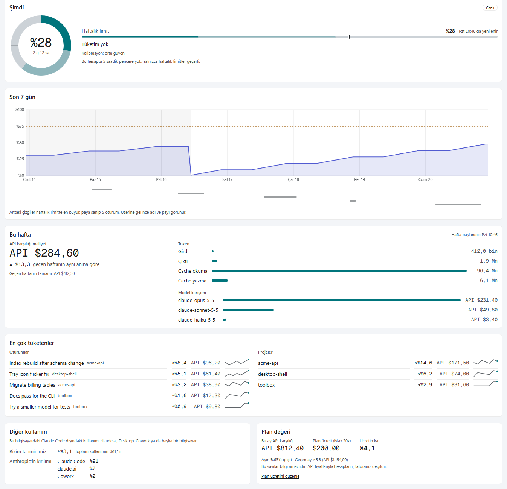
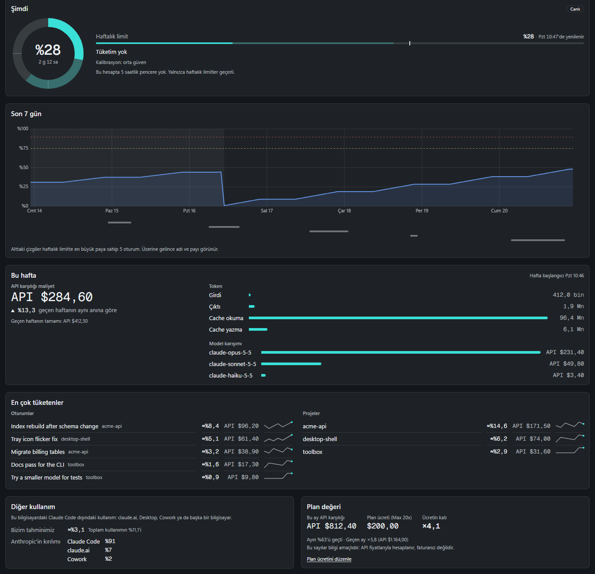
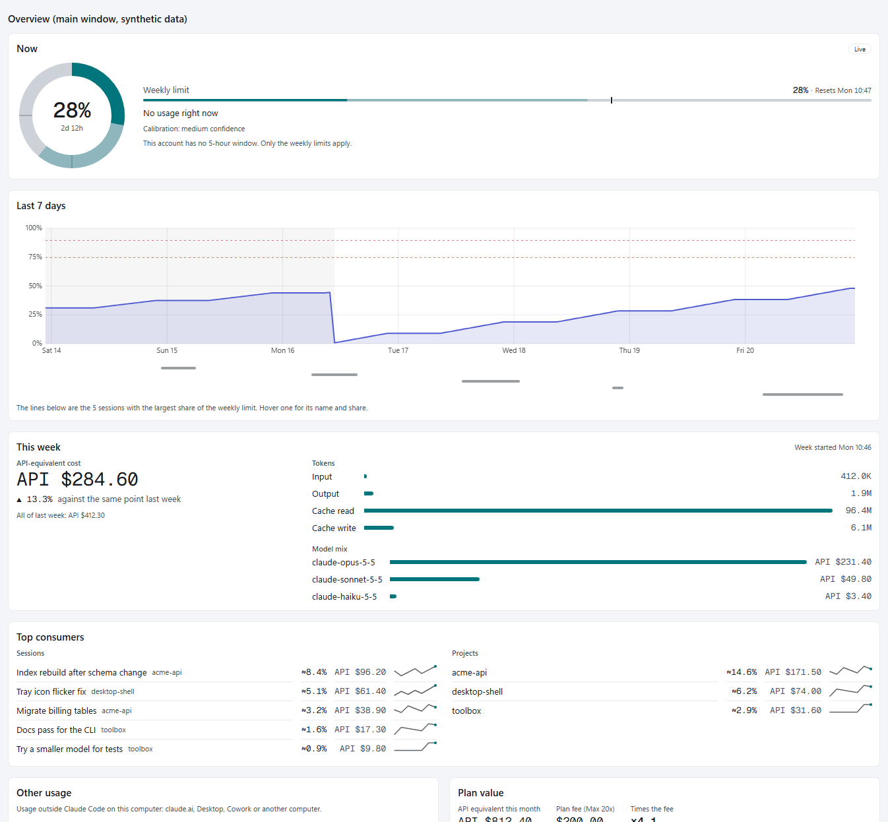
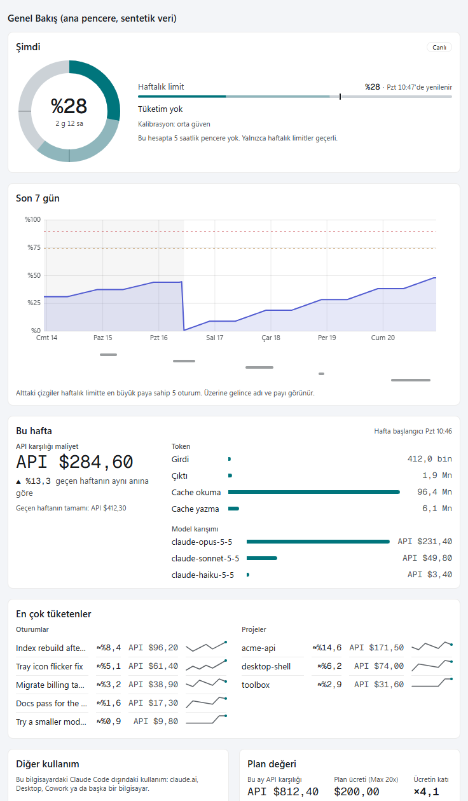

# Adım 15 — Ana pencere kabuğu ve Genel Bakış

| Sürüm | Bağımlılık | Tahmini süre | Durum |
|---|---|---|---|
| v0.2 | 14 | 1-2 oturum | ✅ |

## Amaç

Analitik deneyiminin kapısı olan ana pencereyi yapmak. Bu adım iki parçadan oluşur:

1. **Kabuk:** navigasyon, yönlendirme (routing), pencere yaşam döngüsü, tutarlı yerleşim.
2. **Genel Bakış ekranı:** güncel limitler, 7 günlük % zaman serisi (oturum işaretleriyle), bu haftanın özeti, en yüksek etkili oturum ve projeler, "Diğer" payı, plan değeri kartı ve kalibrasyon güveni.

## Önce oku

- `docs/design-language.md` (tamamı; özellikle §4, §5, §8)
- `docs/architecture.md` §2 (yaşam döngüsü), §5 ("UI'da hesaplama yok" ilkesi)
- `docs/performance-budget.md` (ana pencere satırları, bundle bütçesi)
- Adım 14'teki `get_overview` ve `get_timeseries` görünüm modelleri
- `dataviz` skill'i (grafik renkleri, işaretler, eksenler)

## Kapsam

- `main.html` girişi:
  - Pencere yapılandırması: Mica, çerçeve dekorasyonu (özel başlık çubuğu veya native; karar ver ve gerekçelendir), minimum boyut 900×600, boyut ve konum hatırlama.
  - `warm_ttl` 30 s.
- **Kabuk:**
  - Sol navigasyon: Genel Bakış · Pencereler · Oturumlar · Projeler · Örüntüler · (alt kısımda) Ayarlar.
  - Hash tabanlı, kütüphanesiz minimal router. Rotalar tembel yüklenir (dinamik `import()`).
- **Grafik altyapısı:**
  - uPlot sarmalayıcı (tema token'larından renk alır, EN/TR eksen biçimlendirmesi yapar, tooltip içerir).
  - Ortak `ChartTooltip` bileşeni.
- **Genel Bakış ekranı** (aşağıdaki görevler).
- **Giriş noktaları:**
  - Panelde "Detaylar" butonu (artık görünür).
  - Tray menüsünde "TokenRadar'ı aç".
  - CLI komutu `tokenradar open`.

## Kapsam dışı

- Oturumlar ve Projeler (Adım 16), Pencereler ve Örüntüler (Adım 17). Bu adımda bu rotalar boş durum ekranlarıyla yer alır.

## Görevler

- [x] Tasarım: Genel Bakış yerleşimi `frontend-design` veya `impeccable` skill'i ile tasarlanır; ardından `design-language.md` §5'e bir yerleşim taslağı eklenir. **Kontrol listesi:** Bilgi hiyerarşisi şu soruları sırayla yanıtlamalı: (1) Şu an neredeyim? (2) Bu hafta nasıl gidiyor? (3) Ne tüketiyor? (4) Ne kadar değer alıyorum?
- [x] **Kabuk:**
  - Navigasyon etiketleri i18n'den gelir.
  - Klavye kısayolları: `Ctrl+1..5` ile rotalar arasında geçiş, `Ctrl+,` ile ayarlar.
  - Pencere başlığı rotayla güncellenir.
  - Odak yönetimi: rota değişince ana başlığa odaklanılır (ekran okuyucu için).
- [x] **uPlot sarmalayıcı:**
  - Tema değişikliğinde yeniden renklendirir.
  - `ResizeObserver` ile boyutlanır.
  - Yalnızca görünürken çizer.
  - Seri renkleri: 5s için `--signal-ok`, haftalık için ikincil ton; eşik çizgileri (75/90) soluk kesikli; pencere sınırları dikey bantlar olarak çizilir.
- [x] **Genel Bakış bölümleri:**
  1. **Şimdi:** Büyük ikili halka + limit satırları (paneldeki bileşenlerin büyük varyantı) + projeksiyon. Kaynak ve kalibrasyon güveni rozetleri.
  2. **7 gün:** 5s ve haftalık % serisi. Oturum işaretleri (başlangıç ve bitiş noktaları; hover ile oturum adı ve payı). Limite takılan pencereler kırmızı bantla gösterilir. Tahmini bölümler kesikli çizilir.
  3. **Bu hafta:**
     - API karşılığı maliyet.
     - Token kırılımı (input / output / cache read / cache write) yığılmış çubuk olarak.
     - Model karışımı yatay çubuk olarak; donut kullanılmaz.
     - Geçen haftayla karşılaştırma (▲▼ %).
  4. **En çok tüketenler:** Haftalık limite etkisi en yüksek 5 oturum ve 5 proje: `≈ %` değeri, maliyet, mini sparkline. Tıklanınca ilgili detay sayfası açılır (Adım 16'da etkinleşir).
  5. **Diğer:** claude.ai, Desktop ve Cowork payı. Kendi tahminimiz ve `seven_day_breakdown` yan yana gösterilir; şüpheli fark varsa bilgi notu eklenir.
  6. **Plan değeri:** "Bu ay API karşılığı $X · Plan ücreti $Y · ×Z". Ayarlarda plan ücreti düzenlenebilir. "Bu sayılar bilgi amaçlıdır" notu bulunur.
- [x] **Boş durumlar:**
  - Kalibrasyon verisi yetersiz: "Atıflar ≈ X gün sonra kesinleşecek" + mevcut veri.
  - Yalnızca tahmini veri var.
  - Hiç snapshot yok.
- [x] **Performans:**
  - Ana pencere soğuk açılış ≤ 600 ms, bellek ≤ 180 MB.
  - Bundle ≤ 180 KB JS (gzip; uPlot dahil).
  - Rota geçişi ≤ 100 ms.
  - Ölç ve raporla.
- [x] **Testler:** Router (Vitest), grafik veri dönüşümleri, biçimlendirme. Galeri sayfasına grafik bileşenleri eklenir.

## Teknik notlar ve tuzaklar

- **uPlot ve CSS değişkenleri:** uPlot canvas üzerine çizdiği için CSS değişkenlerini doğrudan okuyamaz. Tema değişince `getComputedStyle` ile renkler okunur ve grafik yeniden oluşturulur.
- **Büyük seriler:** Seyreltme backend'de (LTTB) yapılır. Frontend asla ham veri işlemez.
- **Pencere boyutu ve konumu:** `tauri-plugin-window-state` veya kendi `kv` kaydı kullanılabilir. Monitör çıkarılırsa pencerenin ekran dışında kalmaması için sınır kontrolü yapılmalı.
- **Ana pencere ve panel aynı anda açık olabilir.** Olay abonelikleri pencere başına ayrı tutulmalı ve gereksiz yere çoğaltılmamalı.

## Kabul kriterleri

- [x] Genel Bakış, gerçek veriyle 4 soruyu da tek ekranda yanıtlar (devir notunda ekran görüntüsü).
- [x] Tüm sayılar kaynak ve tahmin durumunu doğru gösterir; "≈" işareti ve kesikli çizgi tutarlı kullanılır.
- [x] Performans ve bundle bütçeleri sağlanır.
- [x] EN ve TR biçimlendirmeleri doğrudur (eksen etiketleri, tarih ve saat, para birimi).

## Doğrulama

```powershell
pnpm -C app test; pnpm -C app check
pnpm -C app build; node scripts/check-bundle-size.mjs
pnpm dev
.\scripts\measure-memory.ps1 -ProcessName tokenradar-app -Scenario main-window
```

## Devir notu

### 15a (2026-11-20, ADR-066)

**Yapılanlar:**
- **Çekirdek:** `tokenradar_core::deeplink`. `MainRoute` (5 sayfa) ve `Link { Panel, Main(Option<MainRoute>) }`; `uri`, `parse`, `find`.
- **Uygulama (`main_window.rs`):**
  - Gizli oluşturma; `main_ready` ya da 1,5 sn zaman aşımında gösterme.
  - Kapatmada gizleme, 30 sn TTL ile yok etme.
  - Geometri `kv.main_window_geometry`'de; başlık şeridi erişilebilirlik kontrolü.
  - Başlık `document.title`'ı izler.
  - Komutlar `open_main(route)` ve `main_ready`, olay `main-route-requested`.
  - Tek örnek, ilk başlatma ve toast aynı `open_link` yolundan geçer.
- **Giriş noktaları:**
  - Tray menüsünde "TokenRadar'ı aç".
  - Panel başlığında pencere simgeli düğme ("TokenRadar'ı aç").
  - `tokenradar open [sayfa]`: uygulamayı ayrık süreç olarak bağlantıyla başlatır.
- **Frontend:**
  - `main.html`. `Main.svelte` kabuğu: 200 px navigasyon, `aria-current`, `h1` odağı.
  - Hash router (`router.ts`), `Ctrl+1..5` ve `Ctrl+,` kısayolları, tembel sayfa modülleri, `performance.mark/measure` (`route:*`).
  - Dört sayfa "geliyor" boş durumunda. Overview, gerçek veriyle son 7 günün grafiğini gösteriyor (15b'de bölümlerle değişecek).
- **Grafik (`lib/chart/`):**
  - uPlot 1.6.32 sarmalayıcısı. Model (`align`, `valueAt`, tarih ve tick biçimleri; TR/EN).
  - Token'lardan kanvas renkleri, bantlar, eşikler, ortak ipucu, ≥ 2 çizgide açıklama.
  - Yalnızca ekrandayken kurulur; tema ya da dil değişince yeniden kurulur.
  - `series.ts`, `TimeSeries`'i grafik modeline çevirir.
- **Galeri:** iki çizgi + kesikli tahmin + limite ulaşmış bant, yalnızca haftalık, boş durum.
- **Belgeler:** design-language (`--series-2`, kabuk, zaman grafiği), architecture (§2 ana pencere ve deep link, §11 `open`), ADR-066.

**Doğrulama:**
- Biçim ve testler: `cargo fmt`, `cargo clippy --workspace --all-targets -D warnings` temiz. Core deeplink 4, CLI 29, app 104 test geçti. `pnpm -C app test` 157/157 geçti; `check` ve `lint` temiz.
- Build: `pnpm -C app build` başarılı. `check-bundle-size`: `main.html` JS 60,4 / 180 KB (giriş + tüm tembel sayfalar, gzip), panel 45,8 / 60 KB.
- Gerçek veriyle deneme: gerçek veritabanının kopyası portable modda, debug build ile.
  - Tray ve panel → `open_main` çalıştı. TTL sonrasında CLI `tokenradar open overview` pencereyi yeniden açtı.
  - Debug soğuk açılış 118 ms (release ölçümü 15b'de).
  - Açık ve koyu tema ekran görüntüleri incelendi.
- Bulunan hata: tema değişiminden sonra imleç yanlış zamana eşleniyordu (uPlot'un önbelleğe aldığı dikdörtgen). Her kurulum ve boyutlanmadan sonra `syncRect()` çağrılarak düzeltildi; CDP ile yeniden doğrulandı.

**Karar (oturum sonunda):** `--series-2` mavisi ve "renk limite bağlı" kuralı kullanıcı tarafından onaylandı (ADR-066).

**Sapmalar:**
- Adım ikiye bölündü (kullanıcı kararı).
- Doğrulamadaki `measure-memory.ps1 -Scenario main-window` parametresi betikte yok. Betik `-ProcessName`/`-RootPid` ve süre alıyor; senaryo 15b'de elle sürülecek ya da betiğe eklenecek.
- Bundle bütçesinde CSS sınırı yok (performance-budget.md'de tanımlı değil); yalnızca raporlanıyor.

**Açık konular (kullanıcı onayı bekleyen öneriler, ADR-066):**
- Geometrinin `kv`'de tutulması, CLI'ın uygulamayı bağlantıyla başlatması, başlığın `document.title`'ı izlemesi.

**15b'ye notlar:**
- Overview'daki "geliyor" metni ve geçici grafik, bölümler gelince kaldırılmalı (`main-soon-overview*` anahtarları).
- Release build ile ölçülecekler: soğuk ve sıcak açılış, rota geçişi (`performance.getEntriesByName('route:*')`), bellek.
- Kurulu uygulama açıkken debug build ona devreder. Ölçümden önce kullanıcıya sorulmalı.
- Gerçek DB ile debug çalışması sahte mod olmadan pipe'ı sunar. O sırada gelen statusline okumaları portable kopyaya gider. Bu oturumda ≈ 15 dakikalık okuma gerçek DB'ye girmedi.
- Gerçek veride 7 günlük aralığın başında pencere bandı soldan kesik başlıyor; `windows`'un aralık dışına taşanları kırpılıyor, bu doğru.
- Eşik çizgisi 75 açık temada gri-zeytin görünüyor (`--signal-warn` %60 karışım); 15b ekran incelemesinde değerlendirilmeli.
- İpucu, imleç yakınındaki çizginin üstünü örtebiliyor.

### 15b (2026-11-20, ADR-067)

**Yapılanlar:**
- **Çekirdek (`queries::overview`):**
  - `Overview.absent` (panel gibi "5 saatlik pencere yok" bilgisi).
  - Haftanın aynı anıyla karşılaştırma: `previous_cost_to_date` ve `change`. `previous_cost` geçen haftanın tamamı olarak kaldı.
  - Plan değeri: `month_elapsed`, `previous_month_cost`, `previous_ratio` (`MonthSpan`, yerel saatle).
  - `config::save_plan_fee` (birincil hesabın `plan_fee_usd`'i, boş ya da geçersiz değer anahtarı siler).
- **Uygulama:** `set_plan_fee` komutu, `DataSourcesView.plan_fee` (tablo planı ve ücreti, kullanıcının ücreti), `SettingsSection::Plan`.
- **Genel Bakış (`pages/main/overview/`):**
  - Bölümler yukarıdan aşağı: Şimdi · Son 7 gün · Bu hafta · En çok tüketenler · Diğer | Plan değeri. Ortak düzen `OverviewBody`; sayfa ve galeri aynı bileşeni kullanır.
  - Görünüm yardımcıları `overview/view.ts`: token satırları, model satırları, oturum şeridi, değişim yönü, kısa sayı, veri durumu.
  - Canlı yenileme: dört çekirdek olayında en fazla 10 sn'de bir, pencere görünür olunca hemen.
  - Boş durumlar: limit okuması yok (statusline ve API düğmeleri), yalnızca tahmin, kalibrasyon öğreniliyor (düzey + aralık sayısı), haftalık pencere bilinmiyor, bu hafta kullanım yok, plan ücreti bilinmiyor.
- **Bileşenler:** `Sparkline`, `BarList`, grafikte oturum şeridi (`ChartSpan`, `spanBox`, `bbox`'tan hizalama).
- **Ayarlar:** Kaynaklar sekmesinde `#plan` kartı (`PlanFeeCard`, `parseFee`); boş = liste fiyatı.
- **Galeri:** oturum şeritli grafik, kıvılcım çizgileri, sentetik Genel Bakış (`gallery/overview.ts`).
- **Belgeler:** design-language (§4 oturum şeridi, büyüklük listesi, kıvılcım çizgisi; §5 Genel Bakış taslağı; §8 terimler), architecture (`Queries` satırı), ADR-067, `docs/perf/2026-11-20-main-window.md`.

**Ekran görüntüleri (sentetik veri, galeri):**

| Açık · TR | Koyu · TR |
|---|---|
|  |  |

| Açık · EN | Dar pencere · TR |
|---|---|
|  |  |

**Doğrulama:**
- `cargo fmt` ve `cargo clippy --workspace --all-targets -D warnings` temiz. `cargo test --workspace`: core 582, app 104, CLI 29 ve diğerleri geçti (sorgu testlerinde haftanın aynı anı ve plan değeri, config'te plan ücreti testleri yeni).
- `pnpm -C app test` 176/176; `check` ve `lint` temiz; `build` başarılı.
- `check-bundle-size`: `main.html` JS 77,9 / 180 KB (gzip), panel 46,5 / 60 KB.
- Release ölçümü (`docs/perf/2026-11-20-main-window.md`): ikinci süreç dahil soğuk açılış medyan 434 ms (≤ 600), `main_ready` 72,6 ms, veri boyanması 161 ms; rota geçişi medyan 9,5 ms, Genel Bakış'a veriyle 42,7 ms (≤ 100); bellek en fazla 129,2 MB (≤ 180), TTL sonrası 13,3 MB.
- Gerçek veriyle deneme: gerçek veritabanının kopyası portable modda, release build ile. Dört soru, değerler ve kaynaklar kontrol edildi. Kopya ve gerçek veriden alınan görüntüler sonra silindi.
- Taşma: release pencerede 900×600, orta boy ve tam ekranda `main` yatay taşmıyor; galeride 640–2400 px arasında taşma yok.

**Ekran incelemesinde bulunanlar ve düzeltilenler:**
- Kullanıcı gördü: tam ekranda sağda boşluk ve dar pencerede yatay kaydırma çubuğu. Nedenler: istenmemiş `max-width: 1200px` (sayfa) ve `520px` (limit satırları), sabit en küçük ızgara genişlikleri, "Şimdi" kartının köşesindeki kaynak rozetinin ipucunun kenardan taşması. Sınırlar kaldırıldı, ızgaralar `minmax(min(…, 100%), 1fr)` oldu, rozet `tip-end` ile sarıldı.
- Dar listede oturum adı ve proje adı birlikte sığmıyordu; liste 420 px'ten darsa proje adı gizlenir, ipucunda görünür.
- Release ölçümünün ilk açılışında sayfa aşağı kaydırılmış göründü; sonraki açılışlarda tekrarlanmadı, nedeni bulunamadı.

**Sapmalar:**
- Token kırılımı yığılmış çubuk değil satırlar (önbellek okuması diğerlerini bastırıyor). Oturum işaretleri nokta değil grafiğin altında bir şerit. "≈ X gün sonra kesinleşecek" yerine güven düzeyi ve aralık sayısı (kullanıcı kararı). Hepsi ADR-067'de.
- Devir notundaki ekran görüntüleri gerçek veriyle değil sentetik veriyle (galeri). Gerçek veride proje adları, oturum başlıkları ve maliyetler görünüyordu; repo açık kaynak olacak (yan ajan notu).
- Genel Bakış 1180×760'ta ve tam ekranda tek ekrana sığmıyor; alt bölümler için kaydırmak gerekiyor.
- `measure-memory.ps1 -Scenario main-window` betikte yok (15a'da da not edildi); `-RootPid` ve elle sürülen senaryo kullanıldı.
- Geniş pencerede token ve model çubukları çok uzuyor; sınır kullanıcının isteğiyle kaldırıldı.

**Karar (oturum sonunda):** ADR-067'nin önerileri (token satırları, oturum şeridinin biçimi, 10 sn kısma, `overview:data` ölçümü) kullanıcı tarafından onaylandı; ADR kabul edildi.

**Açık konular:**
- 15a'dan devreden: 75 eşik çizgisi açık temada zeytin-turuncu görünüyor (değiştirilmedi); ipucunun imleç yakınındaki çizgiyi örtmesi denenmedi.

**Adım 16'ya notlar:**
- En çok tüketenler satırları tıklanabilir değil; detay sayfaları gelince `#sessions/<id>` ve `#projects/<id>` bağlantısı eklenmeli (satır şimdiden `session_id` ve `project.id` taşıyor).
- `OverviewBody` deseni (sayfa + galeri aynı bileşen) liste sayfaları için de sentetik ekran görüntüsünü kolaylaştırır.
